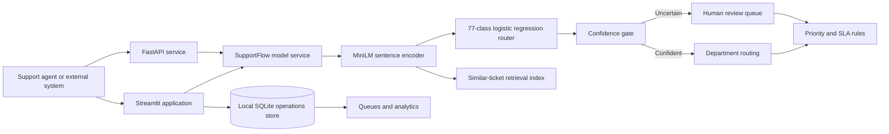

# SupportFlow AI architecture

## System flow

## Main components

| Component | Responsibility |
| --- | --- |
| Streamlit application | Interactive classification, queues, agent review, CSV intake, and analytics |
| FastAPI service | Read-only single and batch prediction endpoints with OpenAPI documentation |
| Sentence encoder | Converts ticket text into a normalized semantic vector |
| Logistic regression | Predicts one of 77 BANKING77 support intents |
| Confidence gate | Automatically routes predictions above the validation-selected threshold and sends uncertain cases to review |
| Retrieval index | Returns semantically similar training examples for supporting context |
| Business-rule layer | Maps intents to departments, priority levels, and first-response SLA targets |
| SQLite store | Persists local demo tickets, reviews, statuses, deadlines, and batch fingerprints |

## Request lifecycle

1. Input is cleaned and length-limited.
2. MiniLM generates a sentence embedding.
3. Logistic regression returns intent probabilities.
4. The top confidence is compared with a threshold selected on validation data.
5. A transparent rule maps the predicted or agent-confirmed intent to a department, priority, and SLA.
6. Similar resolved examples are retrieved using cosine similarity.
7. The API returns the result without persistence; the Streamlit workflow saves only when the user adds a ticket or imports a batch.

## Data and model boundaries

- BANKING77 is a research benchmark, not real bank production data.
- Training and validation data are separated from the official held-out test split.
- Retrieval examples come only from training data.
- The API has no authentication and is intentionally bound to localhost by default.
- Priority and SLA are demo business rules, not learned predictions or contractual promises.
- Real deployment would require authentication, encryption, access controls, monitoring, consented company data, drift detection, and production validation.

## Local ports

- Streamlit app: `127.0.0.1:8503`
- FastAPI service and documentation: `127.0.0.1:8000`
